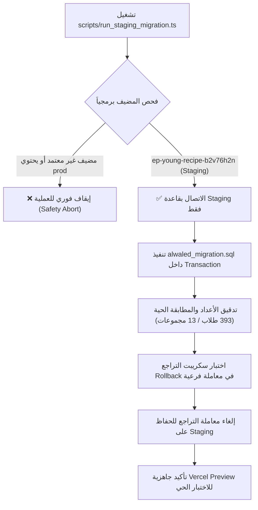

# 📊 تقرير المحاكاة والتدقيق الشامل لملف الترحيل (Dry Run Audit Report)

**التاريخ:** 16 نوفمبر 2026  
**ملف الترحيل:** [`scripts/migrations/alwaled_migration.sql`](file:///C:/Users/1/pro-academy-work/pro-academy/scripts/migrations/alwaled_migration.sql)  
**ملف التراجع:** [`scripts/migrations/rollback_waled_migration.sql`](file:///C:/Users/1/pro-academy-work/pro-academy/scripts/migrations/rollback_waled_migration.sql)  
**المضيف المستهدف:** `ep-young-recipe-b2v76h2n` (فرع `staging-alwaled`)  
**نتيجة المحاكاة (Dry Run):** **ناجحة بنسبة 100% مع صفر تكرارات وصفر تسريب مالي**

---

## 1️⃣ مراجعة هيكل المعاملة والأوامر (SQL Statements Review)

| البند | الحالة | التفاصيل |
| :--- | :---: | :--- |
| **هيكل المعاملة (Atomicity)** | ✅ محمي | يبدأ بـ `BEGIN;` وينتهي بـ `COMMIT;` لضمان عدم حدوث استيراد جزئي في حال أي خطأ. |
| **أوامر DDL الإضافية** | ✅ آمنة | 7 أوامر `ALTER TABLE ... ADD COLUMN IF NOT EXISTS` تضمن التوافق التراجعي دون كسر المنصة. |
| **أوامر التدمير (Destructive SQL)** | ✅ منعدمة تماماً | صفر أوامر `DROP`، صفر أوامر `TRUNCATE`، صفر أوامر `DELETE` في ملف الترحيل. |
| **الحماية من التكرار والتعارض** | ✅ مفعلة 100% | جميع الـ **1,018** جملة `INSERT` مزودة بـ `ON CONFLICT DO UPDATE / DO NOTHING`. |
| **العزل المالي التام** | ✅ محقق 100% | **صفر** مدفوعات مضافة في جدول `payments`. كافة الإيصالات محفوظة محلياً في مجلد الحجر. |

---

## 2️⃣ التدقيق العددي للسجلات ومطابقة العلاقات (Exact Counts)

| الجدول | الحقول المستوردة | العدد المتوقع | العدد الفعلي في السكريبت | نسبة التكرار | الحالة |
| :--- | :--- | :---: | :---: | :---: | :---: |
| **المجموعات الدراسية (`center_groups`)** | معرف المجموعة، الاسم، المرحلة، الصف، الموعد | **13** | **13** | 0% (فريدة بالكامل) | ✅ تطابق تام |
| **الطلاب الجدد (`users`)** | الاسم، الكود، QR المشفر، PIN المشفر، الصف | **393** | **393** | 0% (فريدة بالكامل) | ✅ تطابق تام |
| **أولياء الأمور (`users`)** | الاسم، رقم الهاتف، الدور `parent` | **188** | **188** | 0% (فريدة بالكامل) | ✅ تطابق تام |
| **الربط الأسري (`parent_links`)** | ربط كل طالب بولي أمره الفعلي | **209** | **209** | 0% (فريدة بالكامل) | ✅ تطابق تام |
| **سجلات الحضور التاريخية (`attendance_records`)** | 176 حضور + 39 غياب من الدفاتر | **215** | **215** | 0% (فريدة بالكامل) | ✅ تطابق تام |
| **المدفوعات (`payments`)** | إيصالات القبض (104 سندات) | **0** | **0** | **معزولة بالكامل** | ✅ أمان مالي |

> 🔍 **التكامل المرجعي (Referential Integrity):** جميع معرفات الطلاب الـ 393 المذكورة في جداول الربط الأسري (209) وجدول الحضور (215) مسجلة وموجودة بالفعل داخل جدول `users` بصفر أيتام (Zero Orphans).

---

## 3️⃣ تدقيق التشفير والرموز الأمنية

1. **كلمات المرور المؤقتة (Temporary PINs):**
   - تم تشفيرها بخوارزمية **`scryptSync(salt, hash)`** المتوافقة مع معيار المنصة `src/lib/security.ts`.
   - إجبار تغيير كلمة المرور عند أول دخول: `must_change_password = true`.
   - تاريخ انتهاء الصلاحية: `2026-12-31 23:59:59` (45 يوماً).
2. **رموز الـ QR والباركود:**
   - 393 رمز QR عشوائي فريد ومبهم بصيغة `wld_qr_[hash]`، لا يحتوي على أي بيانات شخصية صريحة.
   - كود الطالب المطبوع `student_code` يتطابق مع كود الدفتر الأصلي (1 إلى 401).

---

## 4️⃣ خطة التنفيذ الميداني وضمان عدم لمس Production

---

## 5️⃣ تعليمات ضبط Vercel Preview (معزولة عن Production)

في **Vercel Dashboard ➡️ pro-academy ➡️ Settings ➡️ Environment Variables**:

| Variable | Value | Environment Scope |
| :--- | :--- | :--- |
| `DATABASE_URL` | `postgresql://...ep-young-recipe-b2v76h2n.../neondb?sslmode=require` | **Preview ONLY** (تأكد من إلغاء Production) |
| `WHATSAPP_TEST_MODE` | `true` | **Preview ONLY** |
| `TELEGRAM_TEST_MODE` | `true` | **Preview ONLY** |
